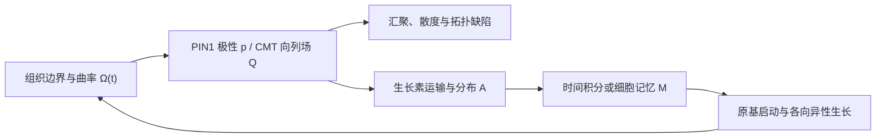

# 两篇论文的植物学建模总结：边界几何、极性缺陷与生长素时间积分

## 0. 论文身份与阅读范围

用户给出的**标题与链接对应两篇不同论文**：

1. Pamela C. Guruciaga, Takafumi Ichikawa, Steffen Plunder, Takashi Hiiragi, Anna Erzberger. **Boundary geometry controls a topological defect transition that determines lumen nucleation in embryonic development**. *Nature Materials* 25, 1278–1287 (2026). [正式论文](https://doi.org/10.1038/s41563-026-02594-7)；[含完整公式和补充推导的 arXiv HTML](https://arxiv.org/html/2403.08710v3)。
2. Carlos S. Galvan-Ampudia, Guillaume Cerutti, Jonathan Legrand, et al. **Temporal integration of auxin information for the regulation of patterning**. *eLife* 9:e55832 (2020). [论文正文](https://doi.org/10.7554/eLife.55832)。

第一篇研究鼠胚，不是植物论文；它与植物学的联系属于**可检验的跨系统建模迁移**。第二篇直接研究拟南芥茎尖分生组织（shoot apical meristem, SAM），是植物叶序与生长素建模的直接证据。

本文采用以下标记：

- **论文结论**：原文有模型、数据或实验支持。
- **植物迁移推断**：数学结构可迁移，但尚未由这两篇论文在植物中验证。
- **建议扩展**：为植物模型提出的新方程或实现方案，不是原文已有模型。

## 1. 一页结论

两篇论文分别补上植物形态发生模型容易忽略的两个维度：

1. **几何不是被动背景。** Guruciaga 等表明，在具有边界诱导极性取向的三维组织中，边界形状本身可以改变拓扑缺陷的类型和位置；在特定强有序、强锚定区域内，这一转变对材料参数相当稳健。
2. **生长素不是瞬时阈值。** Galvan-Ampudia 等表明，SAM 中的生长素高值区相对细胞网络向外传播，速度可高于组织生长；器官发生相关转录响应还需要对生长素暴露进行时间积分。
3. **对植物建模的最直接修改**是把经典的“当前生长素浓度超过阈值便产生原基”改为“细胞累积一段时间的生长素历史后才进入原基状态”。
4. **更进一步的联合模型**应让真实组织几何约束 PIN1 或其他取向场，再由该场控制生长素运输；生长素历史控制原基启动，原基生长又反过来改变组织几何。



---

# 2. 论文一：边界几何控制三维极性缺陷与管腔成核

## 2.1 核心问题

论文研究：一个被不同类型表面包围的三维极性材料，其内部取向场是否由材料参数、边界锚定和边界几何共同决定；如果形成拓扑缺陷，这些缺陷是否具有发育功能。

作者把鼠胚 epiblast 中细胞的顶—底极性粗粒化成三维极性序参量 \(\mathbf p(\mathbf r)\)。与细胞外基质（ECM）接触的边界偏好极性垂直于表面，组织—组织界面偏好极性沿表面排列。两种边界条件在弯曲组织中不能处处无冲突地延伸到内部，因此可能迫使极性场出现奇点。

## 2.2 主要贡献及新颖性

- 🟢 **几何驱动、保持总电荷的缺陷转变**：在论文考察的轴对称“橡果形”边界族和强有序区域内，仅改变边界形状，就会使径向 \(+1\) 点缺陷转变为双曲 \(+1\) 点缺陷与无净电荷的径向向错环（radial disclination ring）组合。
- 🟢 **赋予三维极性缺陷明确的发育功能**：缺陷预测细胞顶端面汇聚、rosette 形成和管腔成核的位置；形状扰动会在预测位置诱导额外管腔。
- 🟡 **将液晶连续体用于胚胎组织**：Landau–de Gennes/Frank 型能量、弱边界锚定和有限元本身是已有方法；新意主要在混合边界、几何相变及生物验证。
- 🔵 **定量工程贡献**：三维细胞分割、细胞主轴提取、跨旋转截面和跨胚胎的 \(Q\) 张量平均、形状拟合及开源有限元代码。

## 2.3 连续场模型

组织占据三维区域 \(\Omega\)，体积为 \(V_0\)。全局有序度为：

```math
P=\frac{1}{V_0}\int_\Omega |\mathbf p|\,\mathrm dV.
```

忽略瞬态后，平衡极性场通过最小化自由能得到：

```math
\mathcal F[\mathbf p]
=
\int_\Omega f_B(\mathbf p,\nabla\mathbf p)\,\mathrm dV
+
\int_{\partial\Omega} f_S(\mathbf p)\,\mathrm dS.
```

体能量由恢复项和取向弹性项构成：

```math
f_B=\frac a2|\mathbf p|^2
+\frac{k_0}{2}(\nabla\cdot\mathbf p)^2
+\frac{k_1}{2}[\hat{\mathbf p}\cdot(\nabla\times\mathbf p)]^2
+\frac{k_2}{2}[\hat{\mathbf p}\times(\nabla\times\mathbf p)]^2,
```

其中 \(k_0,k_1,k_2\) 分别惩罚展曲（splay）、扭曲（twist）和弯曲（bend），\(\hat{\mathbf p}=\mathbf p/|\mathbf p|\)。\(a\gtrsim0\) 使无边界作用时的体相偏好无序态，因此该模型专门研究**边界诱导有序**。

弱锚定表面能为：

```math
f_S=\frac w2|\mathbf p-\mathbf p_0|^2,
```

其中 \(\mathbf p_0\) 是边界偏好的方向，\(w\) 是有效锚定强度。三个关键尺度为：

```math
\xi=\sqrt{\frac{k_0}{a}},\qquad
\lambda=\frac wa,\qquad
\zeta=\frac{k_0}{w}=\frac{\xi^2}{\lambda}.
```

- \(\xi\)：边界诱导有序向内部传播的相关长度。
- \(\lambda\)：表面锚定尺度。
- \(\zeta\)：体相弹性相对边界锚定的外推长度；越小表示边界越占优势。
- \(R_0=(3V_0/4\pi)^{1/3}\)：同体积等效球半径，用于无量纲化。

这个模型不是空腔的多相相场模型：它求解的是**极性序参量场**，能够预测空腔容易在哪里开始，却不显式模拟液体界面、泵液或管腔膨胀。

## 2.4 几何参数、相图与主要阈值

理想“橡果形”由下部半球与上部球冠组成，总体积保持不变：

```math
\nu=\frac{z_\alpha}{R_\beta}.
```

- \(\nu=0\)：顶部为平面；\(\nu>0\)：顶部凸；\(\nu<0\)：顶部凹；\(\nu=1\)：完整球体。
- 实验轮廓再引入第二参数 \(\sigma=\cos^{-1}(-c_\beta/R_\beta)\)，用两个球冠拟合真实边界。

论文区分三个层次：

1. \(\lambda\gtrsim R_0\) 才能形成明显的整体有序。
2. \(\xi^*\approx0.4R_0\) 以下，边界取向难以传入内部；\(\zeta^*\approx0.3R_0\) 以下，边界锚定战胜体相弹性并产生体缺陷。
3. 在已经强有序、强锚定且展曲主导的区域，仅改变 \(\nu\) 会发生：

```math
\text{radial }+1
\longleftrightarrow
\text{hyperbolic }+1+\text{radial disclination ring}.
```

正式版本的临界值为：

```math
\nu_c^+=0.38\pm0.04,\qquad
\nu_c^-=-0.56\pm0.09.
```

在专门检验临界点稳健性的扫描中，作者考察了 \(\lambda/R_0\in[10^2,10^6]\)、\(k_0/k_2\in[10,10^2]\) 和相应强有序 \(\xi\) 区间，临界点几乎不随材料参数改变。这里的“几何控制”与“参数无关”必须限定在这个物理区域和形状族内，不能解释成对任意组织、任意边界都普适。后续数据拟合另将参数搜索扩展到更强的展曲主导区域，因此不应把两组扫描范围混为一谈。

一个直观数值例是：若系统已经处于上述强有序区，\(\nu=0.5\) 超过 \(\nu_c^+\approx0.38\)，模型预测径向点缺陷转为双曲点缺陷与有限半径向错环的组合。这里比较的是无量纲形状，不是把 \(0.38\) 当作可直接移植给植物的曲率阈值。

## 2.5 数值与数据连接

- Python 3、FEniCSx/DOLFINx 有限元；先以完整三维计算检查轴对称性，再用 \(r-\theta\) 截面扫描参数。
- 网格分辨率 0.05；非线性 Newton 求解器相对容差 \(10^{-6}\)。
- 以 \(|\mathbf p|<p^*\)、\(p^*\le10^{-2}\) 的低序参量区域定位缺陷；缺陷类型仍含目视判定。
- 从三维细胞分割提取细胞主惯性轴，以细胞伸长程度加权，构建 \(Q\) 张量并对五个胚胎平均。
- 正式版本的最佳区域为 \(\xi/R_0=4.6\)、\(\lambda/R_0=10^3\)、\(k_0/k_2=10^3\)。后两项位于搜索上界，更稳妥的解释是“强锚定、强展曲主导”，而不是两个精确可辨识的材料常数。
- 正常形状、均匀 ECM 包围、削弱 laminin 锚定以及阻断邻近组织内折等实验共同支持“边界取向与几何决定缺陷/管腔位置”。形状扰动的 10 个胚胎中有 6 个出现额外离轴管腔。

## 2.6 对植物建模可迁移什么

| 原论文对象 | 植物候选对象 | 迁移判断 | 必须修改之处 |
|---|---|---|---|
| 顶—底极性向量 \(\mathbf p\) | PIN1 膜极性、定向运输或某些有头尾的生长方向 | 数学类比较强，但不是同源机制 | 在 SAM 上通常应建曲面或细胞图上的极性场，并显式耦合生长素 |
| 细胞长轴/取向 | 皮层微管（CMT）、纤维素微纤丝、主应力轴 | 可迁移取向场思想 | 这些通常头尾等价，应使用向列 \(Q\) 张量和半整数缺陷，不能直接用极性 \(\mathbf p\) |
| ECM 法向锚定、组织界面切向锚定 | 表皮/角质层、组织层界面、分生组织边缘对 PIN/CMT 的机械或化学定向 | 可检验推断 | \(w\) 与 \(\mathbf p_0\) 应随空间、时间和组织类型改变 |
| 展曲/弯曲/扭曲代价 | 邻细胞 PIN 协同、CMT 连续性、组织生长各向异性 | 形式可迁移 | 有效参数须从植物成像与扰动反演，不能直接称为已测得的植物 Frank 常数 |
| 正极性缺陷使顶端面汇聚 | PIN1 汇聚可能产生生长素最大值与原基热点 | 最有价值的功能类比 | PIN 箭头表示运输方向而非细胞顶端面；是否存在量子化绕数必须真正计算 |
| lumen | 叶肉胞间气隙、通气组织或分泌腔 | 仅有形态类比 | 植物空隙常涉及细胞壁伸展、黏附削弱、果胶重塑、膨压或细胞死亡，机制不同 |

## 2.7 不能照搬的地方

1. 鼠 epiblast 在该阶段有频繁邻居交换、近似流体；植物细胞共享细胞壁、邻接关系通常固定，应使用细胞图、vertex/弹簧/有限元或连续生长固体，而不能默认动物上皮式 T1 转换。
2. 原模型是静态能量极小化，不能预测缺陷形成时间、原基生长速度或空腔膨胀；植物中还必须加入生长、分裂、膨压、壁屈服和激素反馈。
3. 实验测量的是无符号细胞长轴形成的向列场，理论是有方向的极性场；二者连接依赖“局部极性反转很少”的假设。
4. 旋转平均和跨胚胎平均会削弱真实的非轴对称性与个体异质性。
5. “parameter-free prediction”更准确地说是：在新形状条件下没有重新拟合参数，且结果在已测试参数区间稳健；模型仍依赖边界类型、形状族和强有序前提。

---

# 3. 论文二：生长素时空信息的时间积分

## 3.1 核心问题

经典叶序模型通常关注“生长素在哪里形成最大值”，并用当前生长素浓度决定新原基。该论文追问：SAM 中的生长素分布怎样随时间移动？一个细胞的转录响应由当前浓度决定，还是由一段时间内的暴露历史决定？

论文组合使用定量比率型 qDII 生长素传感器、CLV3 中央区标记、DR5 转录响应报告器、PIN1-GFP、活体共聚焦成像与专门的计算分析管线。

## 3.2 主要贡献及新颖性

- 🟢 **发现相对细胞网络传播的生长素离心波**：qDII 推断的生长素高值区并非固定在一组细胞上，P2 附近峰值径向速度可超过 \(1\,\mu\mathrm m/\mathrm h\)，快于局部细胞位移。
- 🟢 **为转录输出依赖暴露历史提供强证据**：DR5 激活比生长素积累滞后接近一个 plastochron；外源生长素的浓度和处理时长共同影响响应。
- 🟡 **重新约束 PIN1—生长素叶序图景**：一个 plastochron 内 PIN1 组织尺度方向变化有限；P3–P5 的 YUC1/YUC4 表达和向心 PIN1 场提示非均匀合成与既有运输结构共同产生动态分布。
- 🔵 **建立可复现的定量成像/几何分析工具链**：跨样本配准、群体平均、原基检测、增长估计、细胞追踪、时间索引及 PIN1 极性矢量化。

## 3.3 最重要的定量结果

论文使用的观测量是比率型代理，而不是绝对生长素浓度：

```math
qDII_n=\frac{DII_n}{TagBFP_n},\qquad
A_{\mathrm{proxy},n}=1-qDII_n.
```

普通语言解释：auxin 促进 DII 降解，因此 qDII 越低，作者绘制的 \(A_{\mathrm{proxy}}\) 越高。例如 qDII 为 0.2 时，图上的 auxin proxy 为 0.8。该量可跨细胞定量比较，但在 DII 不可检出时会饱和到 1，不能当作绝对摩尔浓度。

1. 21 个 SAM 的生长素模式具有很高重复性。把时刻 \(t\) 的平均图旋转约 \(137.5^\circ\)，可近似得到一个 plastochron 后的图样。
2. 论文估计发散角 \(\alpha=137.5^\circ\pm6.7^\circ\)，plastochron \(T=12\pm2\,\mathrm h\)。
3. 生长素最大值从中央区附近向外移动，相对细胞“画布”具有自己的速度，因此组织生长的平流不能单独解释图样移动。
4. 相邻细胞的时间轨迹相近，但不同空间位置的细胞可经历显著不同的生长素历史。
5. PIN1 组织尺度矢量总体强烈指向 SAM 中心，并在生长素最大值伸出中央区时局部偏转；一个 plastochron 内方向变化有限。
6. 生长素输入与 DR5 输出不是简单瞬时一一对应；器官发生相关转录响应滞后接近一个 plastochron。
7. 对 qDII、DR5、CLV3、空间位置等变量的主成分分析中，前两个主轴解释约 75% 变异，而 qDII 输入与 DR5 输出方向近乎正交，进一步反对简单瞬时映射。

## 3.4 论文真正做了哪类“模型”

这篇文章的主要计算贡献是**数据驱动的时空重建模型与图像分析管线**，而不是一个新的 PIN1—生长素反应—运输微分方程求解器。

### 3.4.1 叶序动力系统与时空周期假设

作者把稳定叶序形式化为具有恒定 plastochron \(T\) 和发散角 \(\alpha\) 的动力系统。对于在柱坐标中定义的信号 \(S(r,\theta,z,t)\)，使用：

```math
S(r,\theta,z,t+T)=S(r,\theta+\alpha,z,t).
```

普通语言解释：时间推进一个 plastochron，等价于把平均空间图样绕中心旋转一个发散角。取 \(T=12\,\mathrm h\)、\(\alpha=137.5^\circ\) 时，0 小时图旋转 \(137.5^\circ\) 应近似 12 小时图；这是一条用于重建的稳态对称假设，不是新的生化动力学定律。

这相当于把“一次时间推进”映射成“一次绕 SAM 中心的旋转”。利用同一时刻可见的多个原基阶段，作者从约 10–14 小时的真实观测重建出最长约九个 plastochron（约 100 小时）的平均发育连续体。长期结果使用群体平均的径向速度场和时空周期反复推进，代表重建的细胞群/组织域轨迹，并不是同一细胞被真实追踪了 100 小时。

这个技巧依赖稳定螺旋叶序、近似同步的个体及近似恒定的 \(T\) 和 \(\alpha\)，不适合直接外推到叶序转变、强突变体、快速扰动或明显非周期系统。

附录还用带噪几何模型评估叶序的时空精度：原基半径按 \(r_p=R\exp(\beta\tau_p)\) 增长，并给发散角和相邻起始时间差加入独立高斯噪声；使用 \(R=30\,\mu\mathrm m\)、\(\alpha=137.51^\circ\)、\(\beta=0.23\)，反演得到角噪声约 \(3.6^\circ\)、归一化 plastochron 变异约 0.22（约 2 小时）。附录一个径向差分公式疑有量纲/排版不一致，复现时应以代码和 \(\log(r_p/r_{p-1})\) 检查，而不应机械抄录该式。

### 3.4.2 图像到可比较场的管线

1. 检测三维细胞核并量化每个核中的 qDII、CLV3、DR5 等信号。
2. 用 CLV3 确定中央区，用原基位置确定旋转角与左右手性，把不同 SAM 配准到公共坐标系。
3. 把 L1 表皮细胞的离散测量用局部平滑转成连续二维标量图。
4. 从生长素图的极值区域检测原基，并用黄金角和随阶段增加的径向距离作为几何先验分配原基编号。
5. 用图像形变和细胞核运动估计组织增长及细胞轨迹。
6. 从细胞壁两侧 PIN1-GFP 强度差得到界面极性，再聚合为细胞矢量，最后生成可跨个体平均的组织尺度矢量场和散度图。

原基自动检测的 Jaccard 指数约为 75.4%；只看 P−2 到 P3 时约为 87.3%。PIN1 极性与超分辨率人工估计比较时，80.7% 的细胞矢量偏差小于 \(30^\circ\)。这些数字说明管线可用，但并非无误差的“真值”。

## 3.5 对现有植物模型的直接约束

工作区已有的 [三篇 2006 年 auxin–PIN1 叶序模型总结](./phyllotaxis_three_papers_summary.md) 可据此作四项修改：

1. **模式不应只随组织生长平流。** 如果模型把生长素最大值锁在某组细胞上，它与观察不符；模型必须允许运输/合成—降解动力学使峰值相对细胞移动。
2. **生长素来源不宜默认均匀。** P3–P5 的 YUC 表达提示应加入随原基阶段变化的来源项；中央区、早期原基、较老原基可具有不同 source/sink 角色。
3. **PIN1 不必每个时间步大幅转向。** 生长素波可以在相对稳定的组织尺度 PIN1 场中传播，因此应检验“快速极性反馈”是否被设得过强。
4. **器官启动不能只用瞬时阈值。** 应加入一个慢变量，记录生长素暴露历史或染色质/转录许可状态。

## 3.6 建议加入经典 auxin–PIN1 模型的最小时间积分模块

以下是**根据论文结论提出的建议扩展，不是原文给出的方程**。先保留原有细胞网络上的生长素守恒：

```math
\frac{\mathrm dA_i}{\mathrm dt}
=S_i(t)-\mu_iA_i
+\sum_{j\in N_i}D_{ij}(A_j-A_i)
+\sum_{j\in N_i}(J_{ji}-J_{ij}),
```

其中 \(J_{ij}\) 仍由选定的 PIN1 极化/通量规则决定。为每个细胞增加记忆变量 \(M_i\)：

```math
\tau_M\frac{\mathrm dM_i}{\mathrm dt}=g(A_i)-M_i,
```

普通语言解释：\(M_i\) 是对过去生长素输入的有遗忘低通积分。若暂取 \(g(A)=1\)、\(M(0)=0\)、\(\tau_M=6\,\mathrm h\)，恒定高 auxin 暴露 6 小时后 \(M=1-e^{-1}\approx0.63\)；同样的瞬时浓度若只持续很短时间，\(M\) 不足以跨越启动阈值。

再用 \(M_i\) 而不是 \(A_i\) 触发器官命运：

```math
\Pr(\text{initiation at }i)
=h(M_i-\theta_M)\,C_i\,G_i.
```

- \(g(A)\)：可取 Hill 函数，表示浓度依赖的积分速率。
- \(\tau_M\)：记忆时间尺度，应由不同浓度和脉冲持续时间的数据拟合，而不是直接固定为 12 小时。
- \(C_i\)：周边区/发育能力门控。
- \(G_i\in[0,1]\)：发育许可门；既有原基、中央区或细胞分裂素抑制越强，\(G_i\) 越小。

若数据表现出明显迟滞，可改用带激活—去激活不对称的双稳模块，而不是单一低通滤波器。最关键的模型比较是：

```text
瞬时阈值  vs.  总暴露量积分  vs.  有遗忘的低通积分  vs.  双稳染色质记忆
```

用等总剂量但不同“高浓度短脉冲/低浓度长脉冲”的实验，才能区分这些机制。

## 3.7 局限性

1. qDII 与 DR5 都是代理量：前者反映与 auxin 相关的降解输入，后者受转录、翻译和荧光蛋白成熟影响，不能视为真实浓度与瞬时输出。
2. 时空重建依赖稳态周期、个体同步和群体平均；约九个 plastochron 的连续图不是直接长时观测，个体变异及非稳态过程可能被平滑。
3. PIN1 组织尺度结论样本量较小（主要矢量图为 \(N=4\)），界面极性也存在分割与强度误差。
4. 不同浓度和处理时长支持“时间依赖”，但原实验没有完全区分持续时间本身与浓度—时间积分剂量。
5. ETT/ARF3、组蛋白去乙酰化和染色质状态为合理的时间积分候选机制，但论文没有辨识出唯一的分子记忆方程。
6. 论文没有拟合 \(\tau_M\)、记忆核或完整因果 PIN—auxin—转录动力系统；这些是后续建模空间，而非已确定参数。
7. P0 以 auxin 最大值参与识别和配准，随后又评价 auxin 图样精度，存在一定条件化/循环性；关键位置虽经人工校正，仍应在独立标记下复核。
8. 复现实验剂量时要核对图注：正文一处写“200 nM、300 min”，而补充图注与审稿回复列出的系列是 0、0.2、1、5 mM × 30、120、300 min，前者很可能是单位排版错误。

---

# 4. 两篇论文如何合成一个植物形态发生模型

## 4.1 两篇论文的变量接口

| 联合模型层级 | 论文一提供 | 论文二提供 | 植物模型中的观测/状态 |
|---|---|---|---|
| 几何域 | \(\Omega\)、边界曲率、\(\nu,\sigma\) | SAM 公共坐标、增长/形变场 | 真实 SAM L1 曲面或三维组织网格 |
| 取向场 | 极性 \(\mathbf p\)、向列 \(Q\)、锚定与缺陷 | PIN1 界面→细胞→组织矢量图 | PIN1 极性；若是 CMT 则用 \(Q\) |
| 运输场 | 原论文没有激素输运 | qDII、PIN1、YUC source/sink 图景 | 生长素 \(A\) 与 PIN 通量 \(J\) |
| 时间记忆 | 原论文为稳态 | DR5 延迟与暴露时长依赖 | 细胞记忆/许可变量 \(M\) |
| 发育事件 | 缺陷附近 rosette/lumen | 原基启动与叶序 | 原基出现、局部生长张量改变 |
| 反馈 | 讨论了几何—边界相互作用 | 生长、运输和阶段变化 | 原基改变曲率，曲率再改变极性场 |

## 4.2 推荐的动态耦合框架

下面是**面向植物的建议框架**：

```math
D_t\mathbf p
=-\Gamma\frac{\delta\mathcal F}{\delta\mathbf p}
+\mathbf R_p(A,\boldsymbol\sigma,\text{cell identity})
+\boldsymbol\eta_p,
```

```math
\partial_t A+\nabla_s\cdot(A\mathbf v)
=D_A\Delta_s A
-\nabla_s\cdot\mathbf J_{\mathrm{PIN}}(A,\mathbf p)
+S_Y-\mu A,
```

```math
\tau_M D_tM=g(A)-M,
```

```math
\partial_t\Omega
=\mathcal G(M,A,\mathbf p,\boldsymbol\sigma,\text{cell wall}),
```

其中 \(\nabla_s,\Delta_s\) 是真实 SAM 曲面上的梯度与 Laplace–Beltrami 算子，\(\mathbf v\) 是组织生长速度，\(\boldsymbol\sigma\) 是机械应力，\(\mathcal G\) 控制壁生长、细胞分裂及几何更新。

对离散细胞模型，可把连续自由能换成细胞图上的相邻极性一致性、边界偏好和曲率耦合；这样更符合植物共享细胞壁和固定邻接的特点。

## 4.3 最小可行研究路线

### 阶段 A：先做数据分析，不改动力学

1. 用 `sam_spaghetti` 或等价管线从活体 SAM 图像获得真实曲面、细胞邻接、PIN1 矢量和 qDII 时间序列。
2. 在曲面局部切平面中计算 PIN1 序参量强度、散度和闭合回路绕数；曲面绕数应使用平行移动校正，不能直接用平面角度相减。
3. 检验三种位置的时序关系：PIN1 缺陷/汇聚点、生长素最大值、DR5/原基出现。
4. 用 bootstrap、降低 PIN 信号和随机丢失细胞的模拟，估计“低矢量强度假缺陷”的误报率。

### 阶段 B：在现有叶序模型中只加入记忆变量

1. 在 Smith/Jönsson 类细胞网络模型中加入 \(M_i\)，其余运输规则保持不变。
2. 比较瞬时阈值与不同记忆模型对 plastochron、发散角、扰动恢复和原基错误率的解释力。
3. 用 qDII–DR5 联合时间序列拟合 \(\tau_M\) 或记忆核，并用独立 auxin 脉冲实验验证。

### 阶段 C：再加入几何—极性反馈

1. 从真实 SAM 形状建立曲面有限元或细胞图模型，拟合有效相关长度与边界锚定强度。
2. 做曲率、壁刚度、PIN 总量和生长素合成的正交参数扫描，区分几何效应与生化效应。
3. 预测改变 SAM 圆顶曲率时，PIN1 缺陷是否先于生长素最大值和新原基发生可重复位移或数目改变。
4. 只有当临界点在强有序参数区间发生坍缩，才可声称植物中存在与论文一同类的“geometry-controlled transition”。不能把鼠胚的 \(\nu_c^\pm\) 数值直接移植到 SAM。

## 4.4 三个优先级不同的植物应用

1. **SAM 的 PIN1—auxin—形状模型（最高优先级）**：两篇论文在变量与测量方法上能直接衔接，且可在现有叶序模型上渐进实现。
2. **CMT/纤维素向列场—机械生长模型**：边界几何与拓扑缺陷框架合适，但必须用 \(Q\) 张量，并与各向异性细胞壁和应力反馈耦合。
3. **叶肉胞间气隙模型**：形态上最接近 lumen，但机制差异最大。应使用 deformable-polygon/vertex 或连续固体加空隙相场，把壁黏附、果胶、膨压和壁屈服设为主要成核机制；极性缺陷只能作为待检验的调制因子。

## 4.5 可证伪的联合预测

1. 若边界几何直接组织 PIN1 极性，则在尽量不改变 PIN 总量和生长素合成的形状扰动后，PIN1 绕数/缺陷位置应先改变。
2. 若时间积分是必要的，短时高浓度与长时低浓度即使具有相同终点浓度，也可能产生不同的 DR5 与原基输出；等总剂量实验可进一步区分线性积分和非线性记忆。
3. 若缺陷只是生长素汇聚的描述而非因果组织中心，控制生长素分布后单独改变曲率不会稳定改变缺陷—原基对应关系。
4. 若 CMT 是向列而不是极性变量，观测到的主要缺陷应遵循向列场的半整数绕数规则；强行使用极性向量会产生错误拓扑分类。

---

# 5. 对当前植物建模工作的建议排序

1. **立即做：**在现有 auxin–PIN1 叶序模型中加入时间积分状态 \(M_i\)。这是第二篇论文直接支持、实现成本最低、最容易定量验证的修改。
2. **随后做：**把 PIN1 图从“箭头可视化”提升为曲面极性场，计算散度、序参量幅值和拓扑绕数；先确认植物中是否真的存在论文一所需的缺陷对象。
3. **最后做：**将边界锚定自由能、激素运输、组织力学和移动几何完全耦合。这个阶段适合有限元与细胞图/vertex 混合模型，但参数可辨识性会成为主要风险。

最值得保留的一句话是：

> 植物原基位置可能不只由“哪里的生长素最高”决定，而由“组织几何如何组织极性运输场，以及细胞对这段生长素历史积分了多久”共同决定。

---

# 6. 数据、代码与复现入口

## 论文一

- [Nature Materials 正式论文与 Source Data](https://www.nature.com/articles/s41563-026-02594-7)
- [完整 arXiv HTML 与补充推导](https://arxiv.org/html/2403.08710v3)
- [几何驱动缺陷有限元代码：EMBL GitLab](https://git.embl.de/guruciag/geometry-driven-defects)
- [理论代码 Zenodo 归档](https://doi.org/10.5281/zenodo.19248955)
- [EpiblastOrientationMaps](https://github.com/SteffenPL/EpiblastOrientationMaps)
- [取向分析代码 Zenodo 归档](https://doi.org/10.5281/zenodo.19242875)

## 论文二

- [eLife 正文](https://elifesciences.org/articles/55832)
- [原始图像与处理后数据说明](https://flower.ens-lyon.fr/sam_patterning/)
- [原始 CZI 图像：Zenodo 10.5281/zenodo.3737795](https://doi.org/10.5281/zenodo.3737795)
- [`sam_spaghetti` 文档](https://mosaic.gitlabpages.inria.fr/publications/sam_spaghetti/)
- [`sam_spaghetti` Inria GitLab](https://gitlab.inria.fr/mosaic/publications/sam_spaghetti)
- [`sam_spaghetti` eLife GitHub 归档](https://github.com/elifesciences-publications/sam_spaghetti)

复现提醒：`sam_spaghetti` 文档面向 Python 3.7、Linux/macOS，且依赖多个较老的 Inria 图像分析包；现代环境中最好先锁定 Conda 环境，再逐步迁移依赖。

---

# 7. 三个自测问题

1. 为什么论文二的数据排除了“生长素最大值只被组织生长被动带向外侧”的解释？
2. 论文一所谓“几何控制、材料参数不敏感”成立需要哪些物理区间和几何前提？
3. 如果要把两篇论文合并到 SAM 模型中，为什么 PIN1 可用极性矢量 \(\mathbf p\)，而皮层微管更适合用向列张量 \(Q\)？
