# 茎尖分生组织中央区的生长素水平：文献调研

> 整理日期：2026-11-02。本报告由 AI（Claude）辅助检索与整理。
>
> 图片均截取自原文献，出处写在每张图下方，原始整图保存在 `raw/` 文件夹。图片版权归原出版方，仅供课题内部学习和开题讨论使用。其中 eLife 和 Nature Communications 的图采用 CC BY 4.0 许可；其余文献的图在公开展示前需核对转载许可。

## 结论速览

| 说法 | 证据情况 | 判断 |
|---|---|---|
| 茎尖（整个器官）生长素少 | 幼叶等地上幼嫩组织是生长素的重要来源（Ljung et al., 2001） | 不成立 |
| 中央区对生长素的**转录响应低** | 多个团队、多种方法：DR5 / DR5v2、ARF 与 Aux/IAA 的表达格局、WUS 的调控 | **共识** |
| 中央区**有生长素输入**（含量不低） | Barbier de Reuille et al., 2006；Vernoux et al., 2011；Liao et al., 2015；Luo et al., 2018；Ma et al., 2019；Galvan-Ampudia et al., 2020 | 多个团队支持 |
| 中央区生长素**高于外周、有积累** | 明确这样说的三篇都来自里昂 Traas–Vernoux–Godin 团队：Barbier de Reuille et al., 2006（PNAS）；Vernoux et al., 2011（Mol Syst Biol）；Galvan-Ampudia et al., 2020（eLife） | 有证据，**不是共识** |
| 组织中心（深层 WUS 表达区）低生长素 | Shi et al., 2018（Dev Cell） | 单篇；本次只读到摘要 |
| 生长素经表皮向上运入分生组织，PIN1 向中心汇聚 | Reinhardt et al., 2003（Nature）；Barbier de Reuille et al., 2006；Galvan-Ampudia et al., 2020 | 证据较硬 |

**一句话**：中央区不是生长素匮乏区，而是“有生长素、但不响应”。“中央区生长素明显偏高”是部分研究的发现，不宜写成领域共识。

---

## 1 先分清三个量和三个区

不同方法测的东西不同。把它们混为一谈，是“茎尖（中央区）生长素少”这类说法的主要来源。

| 测的是什么 | 方法 | 局限 |
|---|---|---|
| **含量** | GC-MS 等质谱；IAA 免疫定位 | 质谱需要较多组织，很难在 SAM 内部分区测量。根尖已有“细胞分选 + 质谱”的测量（Petersson et al., 2009），SAM 干细胞还没有同类研究。免疫定位只是半定量 |
| **输入**（细胞感知到的生长素） | DII-VENUS（Brunoud et al., 2012）、R2D2（Liao et al., 2015）、qDII（Galvan-Ampudia et al., 2020） | 读数依赖 TIR1/AFB 受体水平；对中、高浓度的分辨力有限 |
| **转录输出**（响应） | DR5、DR5v2 | 同时取决于生长素和 ARF、Aux/IAA 的组成。**响应低不等于含量低** |

**三个区**（图 1A）：
- **中央区（CZ）**：表层的干细胞区，以 *CLV3* 标记。
- **组织中心（OC）**：中央区下方的深层细胞，表达 *WUS*。
- **外周区（PZ）**：围绕中央区，原基在这里起始。

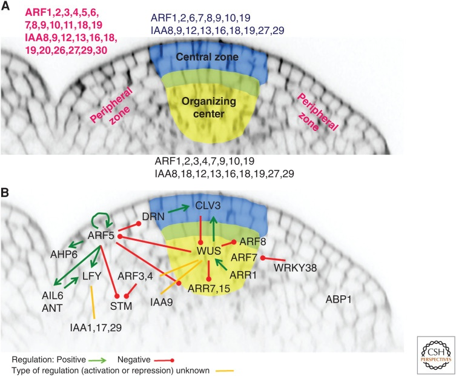

*图 1　SAM 分区，以及生长素信号元件在各区的表达与调控网络。（A）各区表达的 ARF 和 Aux/IAA：中央区（蓝）、组织中心（黄）、外周区（品红字）。（B）已知调控关系，包括 ARF5–DRN–CLV3（Luo et al., 2018）、ARF5 与 WUS 对 ARR7/15 的调控（Zhao et al., 2010）等。来源：Pernisová & Vernoux, 2021，Cold Spring Harb Perspect Biol，Figure 3（整图）。*

---

## 2 中央区生长素含量与输入的证据

### 2.1 Barbier de Reuille et al., 2006（PNAS）：模拟、免疫定位、clv3 质谱

作者把 PIN1 免疫定位图转成细胞网络，用来模拟生长素运输。
- 标准模拟中，生长素在分生组织顶端（summit）明显积累（图 2A）。
- 如果让到达顶端的生长素立即降解，下一个原基位点 I-1 处的生长素最大值也随之消失（图 2B）。
- 如果直接去掉顶端区域，I-1 仍然存在（图 2C）。

作者据此认为：顶端积累参与了原基处最大值的形成，而不是作为“被降解的废物”存在。

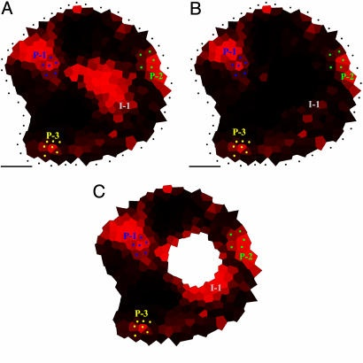

*图 2　基于 PIN1 分布的生长素运输模拟。红色越亮，生长素越高。来源：Barbier de Reuille et al., 2006，PNAS，Fig. 7（整图）。*

实验上：
- DR5::GFP 在未处理、IAA + NPA 处理 22 h、2,4-D 处理 22 h 后，都只在外周扩大，顶端始终没有信号（图 3A–E）。
- IAA 免疫定位却在顶端有明显标记（图 3F 箭头，图 3G 星号）。

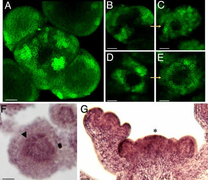

*图 3　（A–E）DR5::GFP：A 未处理；B、C 为 IAA + NPA 处理 0 h 和 22 h；D、E 为 2,4-D 处理 0 h 和 22 h。（F、G）IAA 免疫定位（紫褐色为阳性），F 为横切、G 为纵切。来源：Barbier de Reuille et al., 2006，PNAS，Fig. 5（整图）。*

在中央区扩大的 *clv3* 突变体中，用 GC-MS 测得中央区（CD）的 IAA 显著高于整个茎尖（图 4D，每组 4 个样本；读图约为 20–41 对 12–25 pg/mg）。同时，DR5 只在外周表达（图 4B、C）。

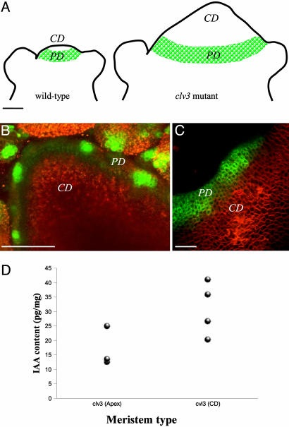

*图 4　*clv3* 分生组织中央区的 IAA 定量。（A）野生型与 *clv3* 的中央区（CD）和外周区（PD）示意。（B、C）DR5::GFP 只在外周表达。（D）GC-MS：茎尖整体（Apex）与中央区（CD）的 IAA 含量。来源：Barbier de Reuille et al., 2006，PNAS，Fig. 6（整图）。*

**局限**：免疫定位只是半定量；GC-MS 用的是 *clv3* 突变体，不是野生型。

### 2.2 Vernoux et al., 2011（Mol Syst Biol）：DII-VENUS

- DII-VENUS 在原基和起始位点处被降解（生长素高），在分生组织**中心同样信号很低**（图 5B）。
- 不可降解的对照 mDII-VENUS 分布均匀（图 5C）。
- DR5::VENUS 则完全不在中心表达（图 5D）。

作者的结论是：中心确有生长素积累，但信号通路限制了转录响应。作者还专门讨论了一个可能的干扰：中心的 TIR1 表达偏低。这只会让 DII 低估生长素，所以中心 DII 信号低，最可能是生长素浓度高所致。

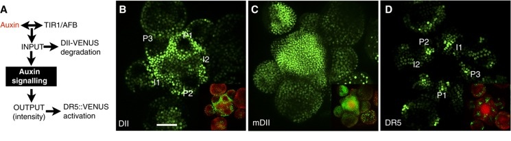

*图 5　（A）DII-VENUS 报告输入、DR5 报告输出的示意。（B）DII-VENUS；（C）mDII-VENUS；（D）DR5::VENUS。P 为原基，I 为起始位点。来源：Vernoux et al., 2011，Mol Syst Biol，Figure 5A–D。*

### 2.3 Ma et al., 2019（Nat Commun）：R2D2 与 DR5v2（Lohmann 组，独立团队）

- R2D2 显示，生长素输入在整个 SAM（包括中心干细胞区）大致均匀；只有幼原基和器官边界处有局部低值（图 6a、b）。
- DR5v2 却在中心最低，位置正好与 CLV3 的峰值互补（图 6c–f）。

这是 Lohmann 组主导的研究，用另一套报告系统（R2D2、DR5v2）支持“中央区有生长素输入，但输出低”。作者中有里昂的 Galván-Ampudia 和 Vernoux，所以不算独立于里昂团队的重复（2026-11-04 更正）。注意它说的是输入**均匀**，并没有说中心**更高**。

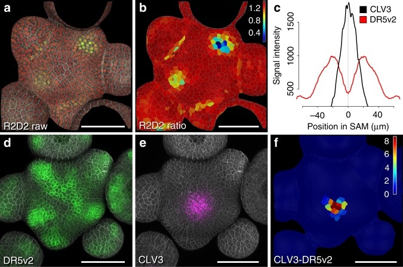

*图 6　（a）R2D2 原始信号；（b）L1 层的 R2D2 比值图；（c）DR5v2 与 CLV3 的平均径向分布（n = 5）；（d）DR5v2；（e）CLV3；（f）二者相减。来源：Ma et al., 2019，Nat Commun，Fig. 1（整图），CC BY 4.0。*

### 2.4 Galvan-Ampudia et al., 2020（eLife）：qDII 定量与 PIN1 极性

作者对 21 个分生组织做了 qDII 定量，并配准后取平均：
- 在生长素图中（图 7C，颜色越深生长素越高），高生长素区紧贴中央区，并以“手指状突起”向 P-2、P-1、P0 方向伸出。中央区本身被 CLV3 的叠加色盖住。
- 作者在讨论中指出，这一图景与“原基在外周局部积累、周围被耗竭”的传统看法不同。

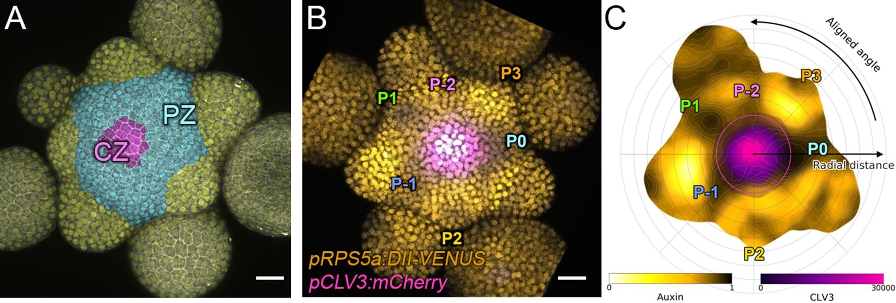

*图 7　（A）中央区（CZ）与外周区（PZ）的划分。（B）DII-VENUS（橙）与 CLV3（品红）。（C）配准后的平均生长素图（0 = 低，1 = 高）与 CLV3 叠加，P-2 至 P3 为各原基位置。来源：Galvan-Ampudia et al., 2020，eLife，Figure 1A–C，CC BY 4.0。*

PIN1 方面：
- PIN1 的平均水平在中央区较低，在外围（尤其 P0–P2 附近）较高（图 8H）。
- PIN1 极性向量在组织尺度上向 SAM 中心汇聚，汇聚处对应生长素图的深色区（图 8I）。
- 作者的总结示意图把中央区画成高生长素区：生长素主要在较老的原基（P3–P5）合成，再由 PIN1 运回中心（图 9）。

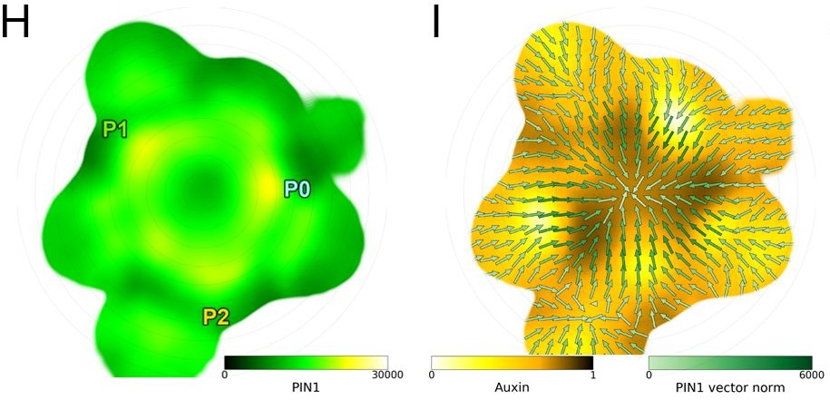

*图 8　（H）PIN1 平均水平图；（I）PIN1 极性向量（绿箭头）叠加在平均生长素图上。来源：Galvan-Ampudia et al., 2020，eLife，Figure 3H–I，CC BY 4.0。*

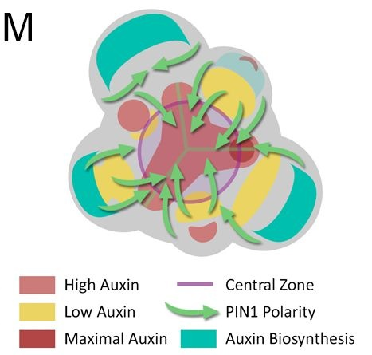

*图 9　作者提出的 SAM 生长素分布与运输示意：粉红为高生长素，深红为最大值，黄为低生长素，青色为生长素合成区，绿箭头为 PIN1 极性，紫圈为中央区。来源：Galvan-Ampudia et al., 2020，eLife，Figure 3M，CC BY 4.0。*

**局限**：
- eLife 的一位审稿人指出，DII 类传感器对中、高浓度分辨力有限；作者回应称，只有 P0 处接近饱和。
- eLife 自 2025 年版 JCR 起不再有影响因子（最后一次公布为 6.4）。

### 2.5 其他文字证据（未配图）

- **Liao et al., 2015（Nature Methods）**：在心形期胚胎的 SAM 中，R2D2 检测到一个 DR5 和 DR5v2 都看不到的生长素输入区。原图面板太小，未截取。
- **Luo et al., 2018（Mol Plant）**：生长素会下行到中央区干细胞，经 MP（ARF5）抑制 *DRN*，进而影响 *CLV3*。
- **Zhao et al., 2010（Nature）**：生长素经 MP 抑制干细胞龛中的 *ARR7*、*ARR15*。这说明生长素在干细胞龛里起作用，但该文没有测含量。

---

## 3 中央区响应低的证据（共识部分）

**Vernoux et al., 2011**：多数 ARF 和 Aux/IAA 在中央区表达低，在外周和原基表达高（图 10）。作者的模型据此预测，中心对生长素的敏感性低。

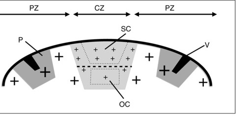

*图 10　ARF 和 Aux/IAA 在分生组织中的分布示意。“+”号越大表示表达越高；CZ 为中央区（灰），SC 为干细胞，OC 为组织中心，P 为原基，V 为维管。来源：Vernoux et al., 2011，Mol Syst Biol，Figure 2ZE。*

**Ma et al., 2019**：
- WUS 通过组蛋白去乙酰化压低生长素通路基因的表达，作者称之为“变阻器”。
- 单加生长素，中心仍然没有 DR5v2；用去乙酰化酶抑制剂 TSA 预处理后再加生长素，中心出现明显的 DR5v2（图 11）。
- 干细胞需要低水平、但不为零的信号：在干细胞中表达显性抑制子 BDL-D，90 株中有 45 株分生组织终止。

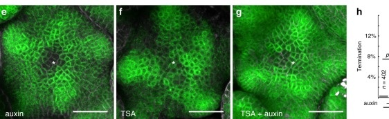

*图 11　DR5v2 对去乙酰化酶抑制的响应。（e）生长素处理；（f）TSA 处理；（g）TSA + 生长素处理。星号为 SAM 中心。来源：Ma et al., 2019，Nat Commun，Fig. 6e–g，CC BY 4.0。*

**其他支持**：
- **Smith et al., 2006（PNAS）**：用 sirtinol（激活生长素信号）处理后，包括中央区在内的所有 L1 细胞都同等表达 DR5::GFP。可见中央区细胞具备响应能力，只是平时被压住。
- **Barbier de Reuille et al., 2006**：外加 IAA 或 2,4-D，也不能让顶端表达 DR5（图 3）。
- **Truskina et al., 2021（Nature）**：ARF 激活子基因的转录受一组抑制因子调控。
- **Pernisová & Vernoux, 2021（综述）**：把中央区概括为“信号输出最低、敏感性低”（图 1）。

（Truskina et al., 2021 中关于 SAM 中心的具体数据，本次只看了综述中的转述，未核对原文。）

---

## 4 反方向与补充证据

- **Shi et al., 2018（Dev Cell）**：组织中心是低生长素区，生长素升高会让 SAM 变小；侧生器官通过调节生长素外运来反馈调控 SAM 大小。本次只读到摘要，所用传感器未核实。注意它说的是深层的组织中心，不是表层的中央区。
- **Yadav et al., 2023（Development）**：*TAA1* 在中央区表皮表达，*TAR2* 不在中央区表达。同组的预印本称 WUS 负调控干细胞龛内的生长素合成；“WUS 抑制合成”这一点目前主要见于预印本。
- **Meng et al., 2017（Plant Cell）**：在离体再生体系中，B 型 ARR 抑制 *YUCCA*、压低生长素，有利于诱导 *WUS*（据摘要）。这是再生体系的结果，不能直接推到正常 SAM。
- **测量本身的限制**：目前没有对 SAM 干细胞做“细胞分选 + 质谱”的研究，中央区的绝对浓度仍缺直接测量。最接近的是 Barbier de Reuille et al., 2006 对 *clv3* 的 GC-MS。

---

## 5 哪些说法是主流

| 说法 | 支持的团队 | 判断 |
|---|---|---|
| 中央区响应低 | 里昂（Vernoux et al., 2011）、Lohmann 组（Ma et al., 2019）、Truskina et al., 2021 等；综述以此为框架 | 共识 |
| 中央区有生长素、含量不低 | 除里昂一系外，还有 Lohmann 组（Ma et al., 2019）、Weijers 组（Liao et al., 2015）、Zhao 组（Luo et al., 2018）；但前两篇的作者都含里昂的 Vernoux 等人，不是完全独立的团队（2026-11-04 更正） | 多个团队支持 |
| 中央区高于外周 | 只有里昂一系的三篇；缺少独立重复。Vernoux 本人 2021 年的综述也只强调“响应低” | 非共识；没有 CNS 级论文专门论证 |

---

## 6 与本课题模型的关系

- **试算中的“运输供给”结构**：
  - 生长素只在发生环外侧产生。
  - PIN 带向心偏置。
  - 中央区 PIN 量为周围的 0.2 倍，这与图 8H 中“中央区 PIN1 偏低”一致。

  在预设的参数网格中，中央区与发生环的生长素之比为 0.98–1.76（20 组里 19 组不低于 1），见 [model_mvp/v2_supply/RESULTS.md](../../model_mvp/v2_supply/RESULTS.md)。
- **“中央区不低”是推论，不是独立假设**：模型里中央区不低，是向心运输的结果，与第 2 节的观测一致。但 PIN 整体向心是直接设定的，模型没有解释它从何而来，所以这种一致不能算独立预测。
- **模型只要求“不低”**：比值从约 1 到 1.76 的设定，都满足“器官依赖极性运输”的设计要求；模型并不需要“明显高于发生环”。
- **中央区不起始器官**：目前靠发生环的定义来实现。计划中的 WUS 响应门控（方案见 [model_mvp/wus_v6/PROTOCOL.md](../../model_mvp/wus_v6/PROTOCOL.md)，已写，未运行）对应第 3 节的共识。

---

## 7 开题写作建议

建议分三层写：

1. **输入（证据最硬）**：生长素经表皮向上运入分生组织，PIN1 极性在组织尺度上向中心汇聚（Reinhardt et al., 2003；Galvan-Ampudia et al., 2020）。
2. **推论（与观测一致）**：中央区生长素不低，部分研究认为偏高（Barbier de Reuille et al., 2006；Vernoux et al., 2011；Ma et al., 2019；Galvan-Ampudia et al., 2020）。
3. **中央区不起始器官**：中央区的转录响应受 ARF/Aux/IAA 表达格局和 WUS 的抑制（Vernoux et al., 2011；Ma et al., 2019）。

可以参考的表述：

> 茎尖分生组织中央区并非生长素匮乏区：DII-VENUS、R2D2 和 qDII 等传感器均显示中央区存在生长素输入，部分研究报道其水平高于外周；但中央区对生长素的转录响应受 ARF/Aux/IAA 表达格局和 WUS 的抑制，因此不起始器官。

避免的写法：“茎尖生长素含量低”“中央区生长素匮乏”；也不要把“中央区高生长素”写成领域共识。

（正式文本按学校要求改用 GB/T 7714 顺序编码制引用。）

---

## 参考文献

- Barbier de Reuille P, Bohn-Courseau I, Ljung K, et al. Computer simulations reveal properties of the cell-cell signaling network at the shoot apex in *Arabidopsis*. *PNAS*, 2006, 103(5): 1627–1632. [doi:10.1073/pnas.0510130103](https://doi.org/10.1073/pnas.0510130103)
- Brunoud G, Wells DM, Oliva M, et al. A novel sensor to map auxin response and distribution at high spatio-temporal resolution. *Nature*, 2012, 482: 103–106. [doi:10.1038/nature10791](https://doi.org/10.1038/nature10791)
- Galvan-Ampudia CS, Cerutti G, Legrand J, et al. Temporal integration of auxin information for the regulation of patterning. *eLife*, 2020, 9: e55832. [doi:10.7554/eLife.55832](https://doi.org/10.7554/eLife.55832)
- Jönsson H, Heisler MG, Shapiro BE, et al. An auxin-driven polarized transport model for phyllotaxis. *PNAS*, 2006, 103(5): 1633–1638. [doi:10.1073/pnas.0509839103](https://doi.org/10.1073/pnas.0509839103)
- Liao CY, Smet W, Brunoud G, et al. Reporters for sensitive and quantitative measurement of auxin response. *Nature Methods*, 2015, 12: 207–210. [doi:10.1038/nmeth.3279](https://doi.org/10.1038/nmeth.3279)
- Ljung K, Bhalerao RP, Sandberg G. Sites and homeostatic control of auxin biosynthesis in *Arabidopsis* during vegetative growth. *Plant J*, 2001, 28: 465–474. [doi:10.1046/j.1365-313X.2001.01173.x](https://doi.org/10.1046/j.1365-313X.2001.01173.x)
- Luo L, Zeng J, Wu H, Tian Z, Zhao Z. A molecular framework for auxin-controlled homeostasis of shoot stem cells in *Arabidopsis*. *Mol Plant*, 2018, 11: 899–913. [doi:10.1016/j.molp.2018.04.006](https://doi.org/10.1016/j.molp.2018.04.006)
- Ma Y, Miotk A, Šutiković Z, et al. WUSCHEL acts as an auxin response rheostat to maintain apical stem cells in *Arabidopsis*. *Nat Commun*, 2019, 10: 5093. [doi:10.1038/s41467-019-13074-9](https://doi.org/10.1038/s41467-019-13074-9)
- Meng WJ, Cheng ZJ, Sang YL, et al. Type-B ARABIDOPSIS RESPONSE REGULATORs specify the shoot stem cell niche by dual regulation of *WUSCHEL*. *Plant Cell*, 2017, 29: 1357–1372. [doi:10.1105/tpc.16.00640](https://doi.org/10.1105/tpc.16.00640)
- Pernisová M, Vernoux T. Auxin does the SAMba: auxin signaling in the shoot apical meristem. *Cold Spring Harb Perspect Biol*, 2021, 13: a039925. [doi:10.1101/cshperspect.a039925](https://doi.org/10.1101/cshperspect.a039925)
- Petersson SV, Johansson AI, Kowalczyk M, et al. An auxin gradient and maximum in the *Arabidopsis* root apex shown by high-resolution cell-specific analysis of IAA distribution and synthesis. *Plant Cell*, 2009, 21: 1659–1668. [doi:10.1105/tpc.109.066480](https://doi.org/10.1105/tpc.109.066480)
- Reinhardt D, Pesce ER, Stieger P, et al. Regulation of phyllotaxis by polar auxin transport. *Nature*, 2003, 426: 255–260. [doi:10.1038/nature02081](https://doi.org/10.1038/nature02081)
- Shi B, Guo X, Wang Y, et al. Feedback from lateral organs controls shoot apical meristem growth by modulating auxin transport. *Dev Cell*, 2018, 44: 204–216. [doi:10.1016/j.devcel.2017.12.021](https://doi.org/10.1016/j.devcel.2017.12.021)
- Smith RS, Guyomarc'h S, Mandel T, et al. A plausible model of phyllotaxis. *PNAS*, 2006, 103(5): 1301–1306. [doi:10.1073/pnas.0510457103](https://doi.org/10.1073/pnas.0510457103)
- Truskina J, Han J, Chrysanthou E, et al. A network of transcriptional repressors modulates auxin responses. *Nature*, 2021, 589: 116–119. [doi:10.1038/s41586-020-2940-2](https://doi.org/10.1038/s41586-020-2940-2)
- Vernoux T, Brunoud G, Farcot E, et al. The auxin signalling network translates dynamic input into robust patterning at the shoot apex. *Mol Syst Biol*, 2011, 7: 508. [doi:10.1038/msb.2011.39](https://doi.org/10.1038/msb.2011.39)
- Yadav S, Kumar H, Mahajan M, et al. Local auxin biosynthesis promotes shoot patterning and stem cell differentiation in *Arabidopsis* shoot apex. *Development*, 2023, 150: dev202014. [doi:10.1242/dev.202014](https://doi.org/10.1242/dev.202014)
- Zhao Z, Andersen SU, Ljung K, et al. Hormonal control of the shoot stem-cell niche. *Nature*, 2010, 465: 1089–1092. [doi:10.1038/nature09126](https://doi.org/10.1038/nature09126)

---

## 图片来源

截取后的图片在 `figs/`，下载的原始整图在 `raw/`。

| 图 | 原文与原图 | 截取部分 | 下载来源 |
|---|---|---|---|
| 1 | Pernisová & Vernoux, 2021，Figure 3 | 整图 | [PMC8634999](https://pmc.ncbi.nlm.nih.gov/articles/PMC8634999/) |
| 2 | Barbier de Reuille et al., 2006，Fig. 7 | 整图 | [PMC1360567](https://pmc.ncbi.nlm.nih.gov/articles/PMC1360567/) |
| 3 | Barbier de Reuille et al., 2006，Fig. 5 | 整图 | 同上 |
| 4 | Barbier de Reuille et al., 2006，Fig. 6 | 整图 | 同上 |
| 5 | Vernoux et al., 2011，Figure 5 | A–D | [PMC3167386](https://pmc.ncbi.nlm.nih.gov/articles/PMC3167386/) |
| 6 | Ma et al., 2019，Fig. 1 | 整图 | [PMC6841675](https://pmc.ncbi.nlm.nih.gov/articles/PMC6841675/) |
| 7 | Galvan-Ampudia et al., 2020，Figure 1 | A–C | [eLife 55832](https://elifesciences.org/articles/55832) |
| 8 | Galvan-Ampudia et al., 2020，Figure 3 | H–I | 同上 |
| 9 | Galvan-Ampudia et al., 2020，Figure 3 | M | 同上 |
| 10 | Vernoux et al., 2011，Figure 2 | ZE | [PMC3167386](https://pmc.ncbi.nlm.nih.gov/articles/PMC3167386/) |
| 11 | Ma et al., 2019，Fig. 6 | e–g | [PMC6841675](https://pmc.ncbi.nlm.nih.gov/articles/PMC6841675/) |

PMC 上的旧版图片（图 2–4）分辨率较低（宽约 410 像素），放大会模糊。需要高清图时，请从出版社网站下载原文 PDF 再截取。
