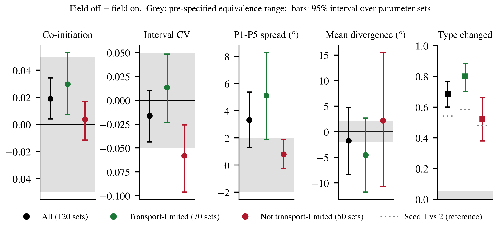

# 模型调整第一步：次级抑制场能不能删（A1）

2026-11-28 · 方案与判据在运行前写定（`model_mvp/ablation_a1/PROTOCOL.md`）· 详细结果 `model_mvp/ablation_a1/RESULTS.md`

**问题**：v3 中模仿 AHP6 的次级抑制场（带 4 个没有测量值的参数）去掉后，叶序统计会不会变？

**做法**：v3 的 120 组参数 × 2 个种子，场开、场关各跑一遍（共 480 次），逐组比较；差值的 95% 区间落在事先定的等效范围（灰色）内才算“可忽略”。

| 指标（全部 120 组） | 场关 − 场开 | 等效范围 | 判定 |
|---|---|---|---|
| 同时起始比例 | +0.019（+0.004，+0.034） | ±0.05 | 可忽略 |
| 原基间隔变异系数 | −0.016（−0.044，+0.010） | ±0.05 | 可忽略 |
| P1–P5 方位离散 | +3.3°（+1.3，+5.4） | ±2° | 证据不足 |
| 平均发散角 | −1.7°（−8.4，+4.8） | ±2° | 证据不足 |
| 叶序类型改变 | 68% 的参数组 | ≤ 5% | 有实质影响 |

**结论：次级抑制场保留，模型这一步不改。** 按事先写定的规则，只有全部指标都可忽略才能删。

- 去掉它，原基位置的离散增大约 3°（受运输限制的参数组约 5°），说明它对精度有小幅贡献。
- 类型改变率（68%）与两个种子之间的差别（54%）相近，主要是不规则运行的轨迹分叉，不能算作场的作用。

**下一步**：A2，检验“茎尖内本地产生”和“产生饱和”能否取 0。
