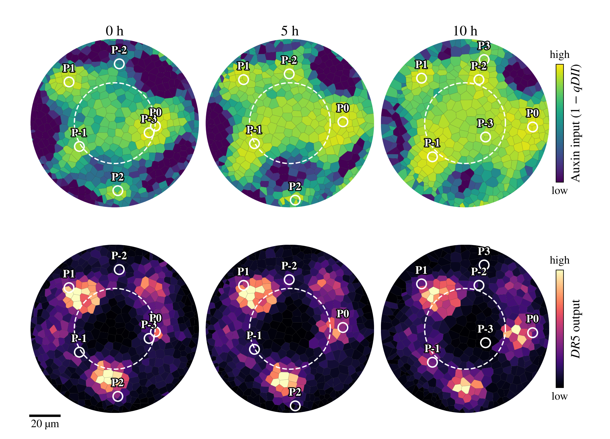
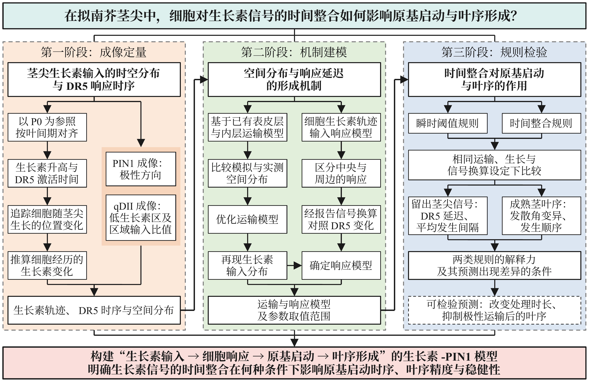
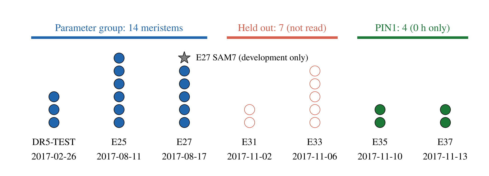
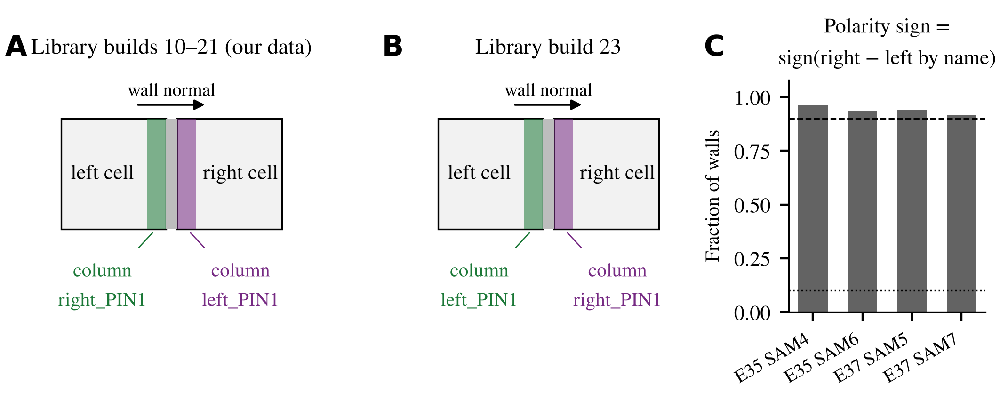
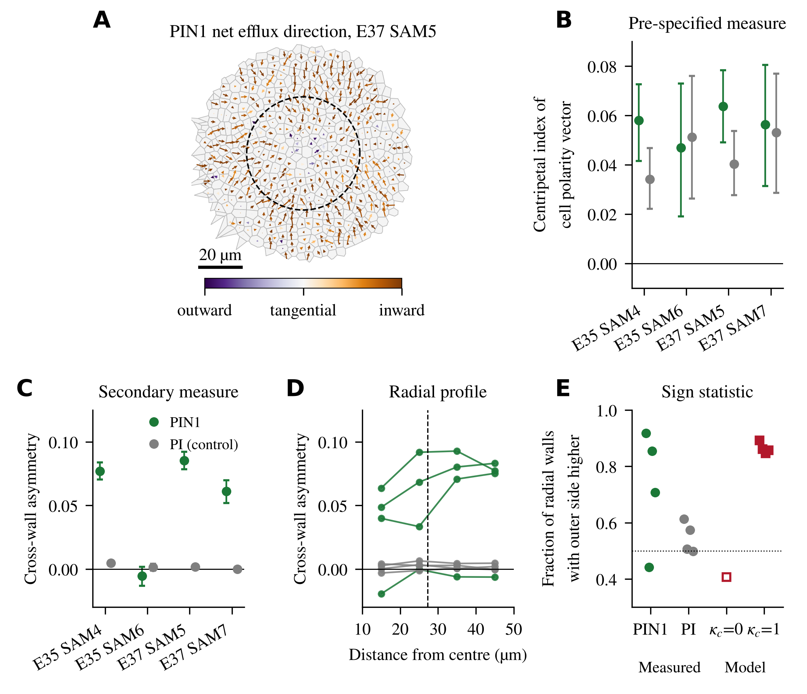
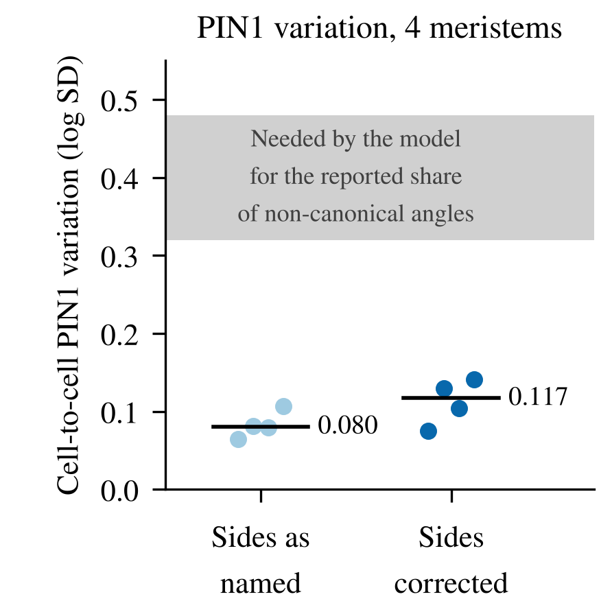

# 进展说明（2026-11-14）

本次工作从读懂项目开始，到完成第一阶段成像定量的第一项测量（PIN1 向心极性）为止，分五个阶段。
详细数字见 [`model_mvp/imaging_s1/RESULTS.md`](model_mvp/imaging_s1/RESULTS.md)，方案见 [`model_mvp/imaging_s1/PROTOCOL.md`](model_mvp/imaging_s1/PROTOCOL.md)。

**一句话总结：** 数据支持 PIN1 整体指向茎尖中心，但向心偏置的强度 κ_c 目前定不出数值；过程中发现此前的细胞间 PIN1 差异取错了一侧的信号，更正后由 0.080 变为 0.117，原判定不变。

---

## 阶段一：读懂项目，确认代码可运行

- 读了阶段性总结、模型说明、各次结构改动的方案与结果，以及核心代码。
- 在云端环境里跑通了求解器检验（质量守恒、线性稳定性、生长网格稳态全部通过）和冻结主线模型的短程运行。
- 确认仓库里已有 21 个茎尖 × 3 个时间点、4 个 PIN1 茎尖的处理结果表格，后续测量不需要重跑图像管线。原始显微图像不在仓库里。

下图是开发用茎尖 E27/SAM7（不在 21 个之内）的三个时间点，用来说明数据的样子：上排是生长素输入，下排是 DR5 输出，虚线是 CLV3 表达区边界，圆圈是作者管线自动标注的生长素输入最大区。

从图上能看到两件事：

- 中央区生长素输入高而 DR5 很弱，DR5 集中在原基处，与文献一致。
- 自动标注对年轻位点不可靠：0 h 时 P−3 紧贴 P0，10 h 时 P−3 落进了中央区。这是后面要先核对位点的原因。

---

## 阶段二：对照开题报告，排出第一阶段的工作顺序

开题报告的技术路线分三个阶段（下图取自开题报告图 2-1）。按进度安排，现在到 2027 年 1 月是第一阶段“成像定量”。

第一阶段拆成六步：

| 顺序 | 工作 | 对应的模型量 | 状态 |
|---|---|---|---|
| 0 | 写定方案：分组、测法、判定标准 | — | 草稿已提交，待确认 |
| 1 | 核对原基位点，建立发育时间轴 | 后面各步的前提 | 待确认后做 |
| 2 | PIN1 向心极性 | 向心偏置 κ_c | **已完成** |
| 3 | DII 报告信号的换算形式 | 步骤 4 的前提 | 形式已写入方案 |
| 4 | 原基周围低生长素区的范围与深度 | 原基作用范围 w、汇强度 η | 需单独确认 |
| 5 | 分阶段信号曲线、DR5 激活时序 | 响应模型的目标 | 待确认后做 |
| 6 | 组织生长率与细胞轨迹 | 时间单位、响应模型的输入 | 只定了路线 |

---

## 阶段三：起草方案，定下留出分组

方案沿用项目一贯的做法：先写测法和判定标准，再看数据；全部结果都报告。

**分组。** 开题报告要求把 21 个茎尖按采集批次分成“确定参数”和“留作检验”两组。分组规则不依赖任何信号：较早的三个批次确定参数，最晚的两个批次留出。留出组本阶段完全不读取。

- 确定参数组 14 个，留出组 7 个，PIN1 茎尖 4 个（样本太少，不分组，只用于约束参数）。
- 开发茎尖 E27/SAM7 只用来写代码和画示例图。

**方案里几处与开题报告字面不同的地方：**

- 原基编号是管线逐帧自动打分的，不保证 0 h 的“P0”就是真正的 P0。所以不直接用整数编号，改用位点半径给每条序列定一个连续的发育相位。
- 叶间期在主分析里定死为文献的 12 h；由数据估计的值只作核对。
- 低生长素区只测 P0–P2，P3 太靠近图像裁剪边界。

---

## 阶段四：读作者源码，发现两侧强度的列名与位置相反

PIN1 的壁表给出每面细胞壁两侧各自的 PIN1 强度，列名是 `left_PIN1` 和 `right_PIN1`。算极性之前必须知道哪一列属于哪个细胞。

我从作者的软件频道取到了计算这些列的外部库的六个构建版本，读源码后发现：**较早的构建（10–21）里，列名与几何位置相反**；最新的构建（23）才改正。

A、B：两类构建里，壁两侧的采样带分别叫什么。C：在数据上的核对，4 个茎尖里 92–96% 的壁符合构建 10–21 的规律（虚线为事先定的判定界限 90%）。

- 这条核对规则是在计算任何极性量**之前**写进方案（修订一）并提交的。
- 核对通过后判定：我们的数据来自较早的构建，细胞本侧的强度要取名字相反的那一列。
- 归属决定符号：在模型快照上试验，把两侧弄反会让向心指数由 +0.50 变成 −0.49。

---

## 阶段五：PIN1 向心极性的测量结果

A：一个茎尖里各细胞的 PIN1 净外排方向，颜色越深越指向中心。B：事先定的主测量，PIN1（绿）与 PI 对照（灰）相当。C：跨壁不对称，PI 对照接近 0。D：跨壁不对称随半径的变化，虚线为 CLV3 区半径。E：径向相邻的细胞之间，外侧一面信号更高的壁所占比例；红色方块为模型。

**结果：**

1. **事先定的主测量无效（图 B）。** PI 均匀染膜，本应没有极性，但它的向心指数（中位数 0.046）与 PIN1（0.057）相当，超过了方案写定的界限。说明这个量受几何和光学偏差支配，按方案不用它约束 κ_c。
2. **事先定的次测量是干净的（图 C）。** PI 对照接近 0，PIN1 在 4 个茎尖里的 3 个明显为正，即极性指向中心。

| 茎尖 | PIN1 跨壁不对称 | PI 对照 | 外侧一面更高的壁占比（PIN1） |
|---|---|---|---|
| E35/SAM4 | +0.077 | +0.005 | 92% |
| E35/SAM6 | −0.005 | +0.002 | 44% |
| E37/SAM5 | +0.085 | +0.002 | 85% |
| E37/SAM7 | +0.061 | −0.000 | 71% |

3. **向心极性从中央区内部延续到 50 µm，外围略强（图 D）。** 模型的径向分布也是外围略强。
4. **幅度不能直接和模型比，符号可以（图 E）。** 显微分辨率把单面壁的不对称度压低了：数据最高约 0.085，模型在 κ_c = 1 时是 0.49–0.54。按符号统计，模型 κ_c = 1 时为 85–89%，与其中两个茎尖相当。
5. **E35/SAM6 没有可检出的极性。** 它的壁数和细胞数最少，PI 的细胞间残差也最大，成像质量可能较差；按方案照实保留。

图 D、图 E 和图 A 的箭头是第一次运行之后加的描述，不在事先写定的内容里；加入时没有改动任何已有数值。

**对建模的含义：** 模型里“PIN 整体向心”这一设定有了直接的数据支持；但 κ_c 取多大，现有的 4 个茎尖给不出数值，只能说明显大于 0。

### 连带更正：细胞间 PIN1 差异

此前测细胞间 PIN1 差异时按列名取本侧强度，实际取的是邻胞一侧。用同一程序按正确归属重算：

- 中位数由 0.080 变为 0.117（范围 0.075–0.141）。
- “实测的 PIN1 差异不足以解释叶序不规则”这一判定不变：模型需要 0.32–0.48，而且 0.12 这一档当时已经放进模型跑过。
- 需要改的是文字和图：开题报告 4.1 节的“0.080”和“4—6 倍”（应为约 3–4 倍）、图 1-1 E，以及此前的结果文件。这些都还没有改。

---

## 待决定的事

1. 是否把跨壁不对称和符号统计作为第二阶段约束 κ_c 的量。
2. 是否更正开题报告和此前结果里的 0.080 及相关文字、图 1-1 E。
3. 是否确认方案其余各节，以便接着做位点核对和 DR5 时序。DR5 时序曲线是最贴合题目的一张图。
4. 开题报告图 1-1 A、B 的示例茎尖是哪一个：若属于留出组，需要在方案里记为一次已知的查看。

## 文件位置

| 内容 | 位置 |
|---|---|
| 方案（含修订一） | `model_mvp/imaging_s1/PROTOCOL.md` |
| 结果 | `model_mvp/imaging_s1/RESULTS.md` |
| 脚本 | `model_mvp/imaging_s1/*.py` |
| 图（png 和 pdf）及原始输出 | `model_mvp/imaging_s1/out/` |

全部已推送到分支 `claude/kind-rubin-w4i26i`。
